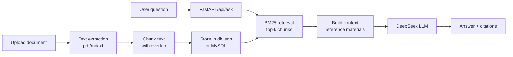

# 📚 RAG Knowledge Base Q&A

> [中文版](README.md)

An **out-of-the-box** RAG (Retrieval-Augmented Generation) knowledge-base Q&A app: upload documents → auto-chunk → retrieve → let the LLM answer from your materials, with traceable citations.

- Pure Python — **no GPU**, no vector database, running in 5 minutes with `pip install`
- Frontend + backend + tests + CI included — a solid **internship / job-hunting project**
- Chinese-first optimizations: sentence-aware chunking, Chinese tokenizer, traceable citations

[](https://github.com/your-name/rag-knowledge-base/actions/workflows/ci.yml)


---

## Features

| Feature | Description |
|---|---|
| Document upload | txt / md / pdf / csv / log, up to 20 MB per file |
| Auto chunking | Sentence-aware splitting + target size + overlap, so meaning is never cut in half |
| Retrieval | BM25 in pure Python (millisecond latency), Chinese single-char + bigram tokenizer |
| Answers with citations | Answers carry `[1][2]` markers; the UI shows the source snippet and score of each citation |
| Anti-hallucination | Prompt strictly says "if it's not in the materials, say so"; empty retrieval → refuse to answer |
| Persistence | `data/db.json` by default; set MySQL vars to store in a database (see below) |
| MySQL storage | Optional: documents + chunks in MySQL — table design, indexes, cascade delete; falls back to JSON if unreachable |
| UI | Vanilla HTML/CSS/JS, no build step, dark mode supported |
| Tests | pytest covering chunking / retrieval / API; GitHub Actions runs them automatically |

## Architecture



## Quick start

**Requirements**: Python 3.11+ (Windows / macOS / Linux)

```bash
# 1. Enter the project directory
cd rag-knowledge-base

# 2. Create a virtual environment (recommended)
python -m venv .venv
# Windows:
.venv\Scripts\activate
# macOS / Linux:
source .venv/bin/activate

# 3. Install dependencies
pip install -r requirements.txt

# 4. Configure the key: copy .env.example to .env and fill in your DeepSeek API Key
#    (skip if DEEPSEEK_API_KEY is already set in your environment)
copy .env.example .env
notepad .env

# 5. Run
uvicorn app.main:app --reload
```

Open **http://127.0.0.1:8000**.

> On first start the sample documents in `data/sample/` are imported automatically — ask "什么是 RAG？" (What is RAG?) to try it.
> API docs: http://127.0.0.1:8000/docs

### Configuration (.env)

| Variable | Default | Description |
|---|---|---|
| `DEEPSEEK_API_KEY` | empty | DeepSeek API Key (system environment variable also works) |
| `DEEPSEEK_BASE_URL` | `https://api.deepseek.com` | OpenAI-compatible endpoint |
| `DEEPSEEK_MODEL` | `deepseek-chat` | Model name, e.g. `deepseek-reasoner` |
| `RAG_TOP_K` | `4` | Number of chunks fed to the model per question |
| `RAG_CHUNK_SIZE` | `600` | Target characters per chunk |
| `RAG_CHUNK_OVERLAP` | `80` | Overlap between adjacent chunks |
| `RAG_TEMPERATURE` | `0.2` | Answer temperature |
| `RAG_DB_HOST` | empty | Set it to use MySQL; empty = JSON file |
| `RAG_DB_PORT` | `3306` | MySQL port |
| `RAG_DB_USER` | `root` | Database user |
| `RAG_DB_PASSWORD` | empty | Database password (keep it in `.env`, never commit) |
| `RAG_DB_NAME` | `rag_kb` | Database name |

## API

| Method | Path | Description |
|---|---|---|
| GET | `/api/health` | Health check (model name, key configured) |
| GET | `/api/stats` | Knowledge-base stats (documents / chunks / characters) |
| GET | `/api/documents` | List documents |
| POST | `/api/documents` | Create a document (JSON: `{name, text}`) |
| POST | `/api/upload` | Upload a file (multipart) |
| DELETE | `/api/documents/{id}` | Delete a document |
| POST | `/api/ask` | Ask a question (JSON: `{question, top_k?}`) |

Example:

```bash
curl -X POST http://127.0.0.1:8000/api/ask \
  -H "Content-Type: application/json" \
  -d "{\"question\": \"什么是 RAG？\"}"
```

## Project structure

```
rag-knowledge-base/
├── app/
│   ├── main.py        # FastAPI entry + routes
│   ├── config.py      # Configuration (env / .env)
│   ├── loaders.py     # File → text (pdf/md/txt)
│   ├── chunking.py    # Text chunking (sentences + overlap)
│   ├── retrieval.py   # BM25 retrieval
│   ├── store.py       # Document store (JSON persistence, default)
│   ├── db.py          # MySQL store + automatic fallback
│   ├── llm.py         # DeepSeek client (retries + errors)
│   └── rag.py         # RAG pipeline (retrieve → context → generate)
├── static/            # Frontend (no build tools)
├── data/
│   ├── sample/        # Sample knowledge base
│   └── db.json        # Generated at runtime (gitignored; not used with MySQL)
├── tests/             # pytest tests
├── docs/LEARNING.md   # Beginner guide + interview Q&A
└── .github/workflows/ci.yml
```

## Running tests

```bash
pytest -q
```

## Optional: MySQL storage

Switching storage from JSON to MySQL needs **no code changes** — just configuration:

**1. Create database and user (once)**

```sql
CREATE DATABASE rag_kb DEFAULT CHARACTER SET utf8mb4;
CREATE USER 'dsh_app'@'localhost' IDENTIFIED BY 'your-password';
GRANT ALL PRIVILEGES ON rag_kb.* TO 'dsh_app'@'localhost';
```

**2. Fill the database settings in `.env`**

```ini
RAG_DB_HOST=127.0.0.1
RAG_DB_PORT=3306
RAG_DB_USER=dsh_app
RAG_DB_PASSWORD=your-password
RAG_DB_NAME=rag_kb
```

**3. Restart the server.** When `/api/stats` returns `"storage": "mysql"` you are done (tables are created automatically). Open `rag_kb` in DataGrip / Navicat to inspect the data.

**Schema** (see `app/db.py`):

| Table | Columns | Notes |
|---|---|---|
| `documents` | id, name, chunks, chars, created_at | one row per document |
| `chunks` | id, doc_id, idx, text, chars | one row per chunk; `doc_id` FK → `documents` |

**Design points (good interview material):**

- **Foreign key + cascade delete**: `ON DELETE CASCADE` removes all chunks of a deleted document — no orphan rows.
- **Index**: an index on `doc_id` avoids full scans when listing chunks or cascading deletes.
- **Fallback**: if MySQL is unreachable the app falls back to JSON (`make_store()`), so the demo runs anywhere.
- **Trade-off**: a fresh connection per operation + autocommit is fine for a demo; production should use a pool, and full-text/vector indexes on `text`.

## Design notes

**Why BM25 instead of vector retrieval?**

- Zero dependencies: no embedding model download (100 MB+), no vector DB to run;
- Good enough: for a small single-machine knowledge base BM25 performs well and answers in milliseconds;
- Replaceable: `app/retrieval.py` exposes a single `search()` function — swapping in FAISS / Chroma / Milvus only touches that file, `rag.py` stays unchanged.

**How to make it production-ready?**

1. Retrieval: BM25 → hybrid retrieval (BM25 + vectors) + rerank;
2. Storage: JSON (default) → MySQL (supported) → vector DB;
3. Chunking: structure-aware splitting (Markdown headings, PDF layout);
4. Evaluation: add a RAGAS evaluation set and regression-test quality;
5. Engineering: multi-turn context, access control, rate limiting, logging & monitoring.

## Roadmap

- [x] MySQL storage backend (documents / chunks tables)
- [ ] Vector retrieval (FAISS/Chroma) + hybrid retrieval
- [ ] Multi-turn conversation context
- [ ] Index consistency check after document deletion
- [ ] Answer rating / feedback button
- [ ] Docker deployment

## Security notes

`.env` (API key and database password) and `data/db.json` are ignored by `.gitignore` and never committed; this README and the sample config contain no real secrets.

## FAQ

- **Error `没有找到 DEEPSEEK_API_KEY`**: check that `.env` is in the project root and has a value, or set the environment variable and restart the terminal.
- **404 / model not found**: set `DEEPSEEK_MODEL` back to `deepseek-chat` in `.env`.
- **Answer "知识库里没有找到"**: make sure the sidebar lists documents; Chinese retrieval is not synonym-aware, so try a different keyword.
- **PDF has no extractable text**: scanned PDFs are images and need OCR (not supported yet).

## License

[MIT](LICENSE)
