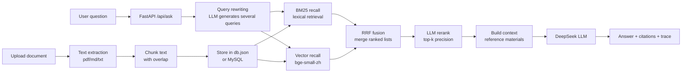

# 📚 RAG Knowledge Base Q&A

> [中文版](README.md)

An **out-of-the-box** RAG (Retrieval-Augmented Generation) knowledge-base Q&A app: upload documents → auto-chunk → hybrid retrieval (BM25 + embeddings) → query rewriting + reranking → let the LLM answer from your materials, with traceable citations.

- Pure Python — **no GPU**, no standalone vector database, running in 5 minutes with `pip install`
- Every retrieval stage is pluggable: BM25 / vector search / RRF fusion / LLM rerank / query rewriting — each can be switched off for ablation
- Frontend + backend + tests + CI included — a solid **internship / job-hunting project**
- Chinese-first optimizations: sentence-aware chunking, Chinese tokenizer, bge Chinese embeddings, traceable citations

[](https://github.com/HDC233666/rag-knowledge-base/actions/workflows/ci.yml)


---

## Features

| Feature | Description |
|---|---|
| Document upload | txt / md / pdf / csv / log, up to 20 MB per file |
| Auto chunking | Sentence-aware splitting + target size + overlap, so meaning is never cut in half |
| Hybrid retrieval | BM25 (lexical) + vector search (bge-small-zh, CPU-only), fused with RRF |
| Query rewriting | The LLM expands one question into several retrieval queries (multi-query recall) |
| Reranking | LLM scoring (default) or bge cross-encoder (local CPU) reorders candidates |
| Caching | Rewrite/rerank results cached in SQLite with TTL — repeat questions go from seconds to milliseconds |
| Answers with citations | Answers carry `[1][2]` markers; the UI shows the source snippet and score of each citation |
| Anti-hallucination | Prompt strictly says "if it's not in the materials, say so"; empty retrieval → refuse to answer |
| Persistence | `data/db.json` by default; set MySQL vars to store in a database (see below) |
| MySQL storage | Optional: documents + chunks in MySQL — table design, indexes, cascade delete; falls back to JSON if unreachable |
| Retrieval eval | 62-question eval set + script: one command to compare BM25 / hybrid / rerank / rewrite on hit@1, hit@3, MRR |
| Streaming | `/api/ask/stream` over SSE: retrieval trace first, then the answer token by token |
| Multi-turn | The frontend sends recent turns so follow-up questions keep context |
| Rate limiting | Per-IP request cap (`RAG_RATE_LIMIT`), `429` when exceeded |
| UI | Vanilla HTML/CSS/JS, no build step, dark mode supported, Markdown rendering |
| Tests | pytest with 33 cases covering chunking / retrieval / fusion / reranking / caching / API / streaming / rate limiting; GitHub Actions runs them automatically |

## Architecture



> Every stage can be disabled via `.env` (`RAG_ENABLE_REWRITE=0` / `RAG_ENABLE_RERANK=0`) and gracefully degrades — handy for ablation studies.

## Quick start

**Requirements**: Python 3.11+ (Windows / macOS / Linux)

```bash
# 1. Enter the project directory
cd rag-knowledge-base

# 2. Create a virtual environment (recommended)
python -m venv .venv
# Windows:
.venv\Scripts\activate
# macOS / Linux:
source .venv/bin/activate

# 3. Install dependencies
pip install -r requirements.txt

# 4. Configure the key: copy .env.example to .env and fill in your DeepSeek API Key
#    (skip if DEEPSEEK_API_KEY is already set in your environment)
copy .env.example .env
notepad .env

# 5. Run
uvicorn app.main:app --reload
```

Open **http://127.0.0.1:8000**.

> On first start the sample documents in `data/sample/` are imported automatically — ask "什么是 RAG？" (What is RAG?) to try it.
> API docs: http://127.0.0.1:8000/docs

### Configuration (.env)

| Variable | Default | Description |
|---|---|---|
| `DEEPSEEK_API_KEY` | empty | DeepSeek API Key (system environment variable also works) |
| `DEEPSEEK_BASE_URL` | `https://api.deepseek.com` | OpenAI-compatible endpoint |
| `DEEPSEEK_MODEL` | `deepseek-chat` | Model name, e.g. `deepseek-reasoner` |
| `RAG_TOP_K` | `4` | Number of chunks fed to the model per question |
| `RAG_CHUNK_SIZE` | `600` | Target characters per chunk |
| `RAG_CHUNK_OVERLAP` | `80` | Overlap between adjacent chunks |
| `RAG_TEMPERATURE` | `0.2` | Answer temperature |
| `RAG_EMBED_MODEL` | `BAAI/bge-small-zh-v1.5` | Embedding model (CPU-friendly, 512 dims); vectors rebuild automatically when changed |
| `RAG_EMBED_BACKEND` | `auto` | `hash` forces the dependency-free hash embedder (CI / offline) |
| `RAG_EMBED_QUERY_PREFIX` | bge instruction | Query-side instruction prefix recommended for bge models; may be left empty |
| `RAG_CANDIDATE_K` | `12` | Candidates recalled by BM25 and by vectors before fusion |
| `RAG_RRF_K` | `60` | RRF fusion constant (empirical value from the paper) |
| `RAG_ENABLE_REWRITE` | `1` | Query rewriting on/off; `0` saves one LLM call |
| `RAG_ENABLE_RERANK` | `1` | LLM reranking on/off; `0` saves one LLM call |
| `RAG_RERANK_BACKEND` | `llm` | `llm` (LLM scoring) or `cross` (bge cross-encoder, local CPU) |
| `RAG_CROSS_ENCODER_MODEL` | `BAAI/bge-reranker-base` | Model used by the `cross` backend |
| `RAG_ENABLE_CACHE` | `1` | Cache rewrite/rerank results in SQLite with TTL |
| `RAG_CACHE_TTL` | `3600` | Cache TTL in seconds |
| `RAG_CACHE_PATH` | `data/cache.db` | Cache file location (gitignored) |
| `RAG_RATE_LIMIT` | `60` | Max questions per IP per minute; `0` disables |
| `RAG_DB_HOST` | empty | Set it to use MySQL; empty = JSON file |
| `RAG_DB_PORT` | `3306` | MySQL port |
| `RAG_DB_USER` | `root` | Database user |
| `RAG_DB_PASSWORD` | empty | Database password (keep it in `.env`, never commit) |
| `RAG_DB_NAME` | `rag_kb` | Database name |

## API

| Method | Path | Description |
|---|---|---|
| GET | `/api/health` | Health check (model name, key configured) |
| GET | `/api/stats` | Knowledge-base stats (documents / chunks / characters) |
| GET | `/api/documents` | List documents |
| POST | `/api/documents` | Create a document (JSON: `{name, text}`) |
| POST | `/api/upload` | Upload a file (multipart) |
| DELETE | `/api/documents/{id}` | Delete a document |
| POST | `/api/ask` | Ask a question (JSON: `{question, top_k?, history?}`) — one shot |
| POST | `/api/ask/stream` | Same body, **SSE stream**: `trace` / `delta` / `done` events |

SSE events (`data: {...}`):

| Event | Payload | Meaning |
|---|---|---|
| `trace` | `{queries, rewrite, rerank, candidates, citations}` | Retrieval finished; citations and trace pushed first |
| `delta` | `{text}` | Incremental answer text |
| `done` | `{answer, citations, latency_ms, tokens, trace}` | Turn finished |
| `error` | `{detail}` | Failure |

Rate limiting: 60 questions per IP per minute by default (`RAG_RATE_LIMIT`, `0` disables). Over the limit returns `429`.

Example:

```bash
curl -X POST http://127.0.0.1:8000/api/ask \
  -H "Content-Type: application/json" \
  -d "{\"question\": \"什么是 RAG？\"}"
```

## Project structure

```
rag-knowledge-base/
├── app/
│   ├── main.py        # FastAPI entry + routes
│   ├── config.py      # Configuration (env / .env)
│   ├── loaders.py     # File → text (pdf/md/txt)
│   ├── chunking.py    # Text chunking (sentences + overlap)
│   ├── embeddings.py  # Embedding model (bge-small-zh / hash fallback)
│   ├── vectorstore.py # Vector index (numpy cosine search)
│   ├── retrieval.py   # BM25 + vector hybrid retrieval (RRF fusion)
│   ├── rewrite.py     # Query rewriting (multi-query)
│   ├── rerank.py      # LLM reranking
│   ├── store.py       # Document store (JSON persistence, default)
│   ├── db.py          # MySQL store + automatic fallback
│   ├── llm.py         # DeepSeek client (retries + errors)
│   └── rag.py         # RAG pipeline (rewrite → hybrid recall → fuse → rerank → generate)
├── static/            # Frontend (no build tools)
├── data/
│   ├── sample/        # Sample knowledge base (incl. distractors for eval)
│   ├── eval/          # Eval set (questions.json) and report (report.json)
│   └── db.json        # Generated at runtime (gitignored; not used with MySQL)
├── scripts/
│   ├── evaluate.py    # Retrieval eval: hit@1 / hit@3 / MRR across configs
│   └── smoke.py       # Real API smoke test
├── docs/
│   └── LEARNING-RAG-ADVANCED.md  # Beginner-friendly deep dive (theory + eval + interview Q&A)
├── tests/             # pytest tests (33 cases)
└── .github/workflows/ci.yml
```

## Running tests

```bash
pytest -q
```

## Retrieval evaluation

The repo ships 62 questions (paraphrased, section-targeted and distractor-aware) and `scripts/evaluate.py`, which runs four configurations and prints retrieval quality side by side:

```bash
python scripts/evaluate.py          # requires a key in .env (rerank/rewrite call the LLM)
python scripts/evaluate.py --no-llm # BM25 vs hybrid only, no API cost
```

Metrics: **hit@1** = share of questions whose gold chunk ranks first; **hit@3** = ranks in the top 3; **MRR** = mean reciprocal rank of the gold chunk.

Baseline (14 chunks, 62 questions, bge-small-zh):

| Configuration | hit@1 | hit@3 | MRR | Latency |
|---|---|---|---|---|
| BM25 only | 0.66 | 0.90 | 0.767 | 4 ms |
| Hybrid recall (BM25 + vectors, RRF) | 0.66 | 0.90 | 0.781 | 19 ms |
| Hybrid + LLM rerank | 0.73 | 0.94 | 0.831 | 1.45 s |
| Hybrid + query rewriting + rerank | **0.77** | **0.97** | **0.864** | 2.63 s |

> Takeaway: on a small corpus BM25 is already strong (most questions contain the exact terms), so most of the gain comes from **reranking and query rewriting**. Hybrid recall moves MRR 0.767 → 0.781 (vectors cover the "different wording" questions) while hit@1 / hit@3 stay flat — which is exactly why you need an eval set: without it you cannot tell whether a change helped or just churned.
> Latency grows from 4 ms to 2.6 s because rerank and rewrite call the LLM; that is why the pipeline caches both (see below).

### Cache

Rewrite and rerank results are cached in SQLite keyed by question + candidate fingerprint (`RAG_CACHE_TTL`, 1 hour by default). Same questions asked again:

| Scenario | Latency |
|---|---|
| First time (cold: one rewrite + one rerank LLM call) | 1.4 – 2.6 s |
| Cache hit (rewrites and rerank scores read from SQLite) | **28 ms** (~50× faster) |

### Rerank backends

| Backend | How it works | Latency | Dependency |
|---|---|---|---|
| `llm` (default) | ask the LLM to score candidates 0–10 | ~1.4 s | API key |
| `cross` | local bge-reranker cross-encoder (fastembed/ONNX) | tens of ms | ~100 MB model download |

If the `cross` model cannot be downloaded or inference fails, the pipeline silently falls back to `llm` reranking.

## Optional: MySQL storage

Switching storage from JSON to MySQL needs **no code changes** — just configuration:

**1. Create database and user (once)**

```sql
CREATE DATABASE rag_kb DEFAULT CHARACTER SET utf8mb4;
CREATE USER 'dsh_app'@'localhost' IDENTIFIED BY 'your-password';
GRANT ALL PRIVILEGES ON rag_kb.* TO 'dsh_app'@'localhost';
```

**2. Fill the database settings in `.env`**

```ini
RAG_DB_HOST=127.0.0.1
RAG_DB_PORT=3306
RAG_DB_USER=dsh_app
RAG_DB_PASSWORD=your-password
RAG_DB_NAME=rag_kb
```

**3. Restart the server.** When `/api/stats` returns `"storage": "mysql"` you are done (tables are created automatically). Open `rag_kb` in DataGrip / Navicat to inspect the data.

**Schema** (see `app/db.py`):

| Table | Columns | Notes |
|---|---|---|
| `documents` | id, name, chunks, chars, created_at | one row per document |
| `chunks` | id, doc_id, idx, text, chars | one row per chunk; `doc_id` FK → `documents` |

**Design points:**

- **Foreign key + cascade delete**: `ON DELETE CASCADE` removes all chunks of a deleted document — no orphan rows.
- **Index**: an index on `doc_id` avoids full scans when listing chunks or cascading deletes.
- **Fallback**: if MySQL is unreachable the app falls back to JSON (`make_store()`), so the demo runs anywhere.
- **Trade-off**: a fresh connection per operation + autocommit is fine for a demo; production should use a pool, and full-text/vector indexes on `text`.

## Design notes

**Why upgrade from BM25 to hybrid retrieval (instead of going all-in on vectors)?**

- BM25 matches terms, costs milliseconds and has zero dependencies — very accurate when the question shares the document's wording;
- Vectors cover paraphrases: "the model keeps answering from old docs after I updated them" vs. "an external knowledge base can be updated anytime" — no lexical overlap, but semantically close;
- Each retriever recalls `RAG_CANDIDATE_K` candidates and the two ranked lists are merged with **RRF (Reciprocal Rank Fusion)**: it only looks at ranks, not scores, which neatly avoids the "BM25 score vs cosine similarity are different scales" problem — `score = Σ 1/(k + rank)`;
- `bge-small-zh-v1.5` is 512-dimensional, runs on CPU and needs no vector database; following bge's recommendation the query side gets an instruction prefix while the document side does not.

**Why LLM reranking and query rewriting?**

- Reranking: recall favors "don't miss" (top-12), rerank favors "rank precisely" (the LLM scores each candidate, take top-4);
- Rewriting: user questions are colloquial and sparse; asking the LLM for 2–3 retrieval queries and fusing them clearly lifts hit rate (hit@1 0.73 → 0.77 on the eval set);
- Both cost latency (milliseconds → seconds), so both are switches: measurable and easy to turn off.

**Why streaming, multi-turn and rate limiting?**

- Streaming: retrieval + generation takes 1–2 s, and the page sits blank until it finishes. Over SSE the retrieval trace and citations arrive first, then the answer streams token by token;
- Multi-turn: follow-ups ("and its downsides?") would be treated as brand-new questions without context; the frontend sends the last few turns so it behaves like a chat assistant;
- Rate limiting: answers cost tokens, and a public demo can be abused. Cap each IP per minute (`RAG_RATE_LIMIT`), return 429, and let health checks through.

**Fallback strategy (a common interview question)**

- Embedding model fails to load → degrade to the hash embedder (`HashEmbedder`) so the service keeps running;
- One retriever errors → degrade to pure BM25;
- Rerank/rewrite output is not valid JSON → keep the original order (rerank) or fall back to the original question (rewrite);
- MySQL unreachable → degrade to JSON storage.

Correctness is covered by tests: `tests/test_hybrid.py` and `tests/test_pipeline.py` exercise fusion ordering, bad-output fallbacks and the trace fields.

**How to make it production-ready?**

1. Storage: JSON (default) → MySQL (supported) → vector DB (Chroma / Milvus);
2. Retrieval: hybrid retrieval (supported) → HNSW index in a vector DB + multi-recall;
3. Chunking: structure-aware splitting (Markdown headings, PDF layout);
4. Evaluation: the current 62 questions are small — grow to 100+ and add RAGAS for generation quality;
5. Engineering: access control, logging & monitoring, rerank caching (done), multi-turn context (done), rate limiting (done).

## Roadmap

- [x] MySQL storage backend (documents / chunks tables)
- [x] Vector retrieval (bge-small-zh) + BM25 hybrid retrieval (RRF fusion)
- [x] LLM reranking + query rewriting
- [x] Retrieval evaluation (62 questions, hit@1 / hit@3 / MRR, multi-config comparison)
- [x] Streaming answers (SSE: retrieval trace + token deltas)
- [x] Multi-turn conversation context (frontend sends recent turns)
- [x] Per-IP rate limiting (`RAG_RATE_LIMIT`)
- [ ] Vector DB (Chroma / FAISS) instead of the in-memory index
- [ ] Answer rating / feedback button
- [ ] Docker deployment

## Security notes

`.env` (API key and database password) and `data/db.json` are ignored by `.gitignore` and never committed; this README and the sample config contain no real secrets.

## FAQ

- **Error `没有找到 DEEPSEEK_API_KEY`**: check that `.env` is in the project root and has a value, or set the environment variable and restart the terminal.
- **404 / model not found**: set `DEEPSEEK_MODEL` back to `deepseek-chat` in `.env`.
- **Answer "知识库里没有找到"**: make sure the sidebar lists documents; if the wording differs a lot from the source, the hybrid retriever can usually still find it — if not, try rephrasing or a different keyword.
- **PDF has no extractable text**: scanned PDFs are images and need OCR (not supported yet).

## License

[MIT](LICENSE)

