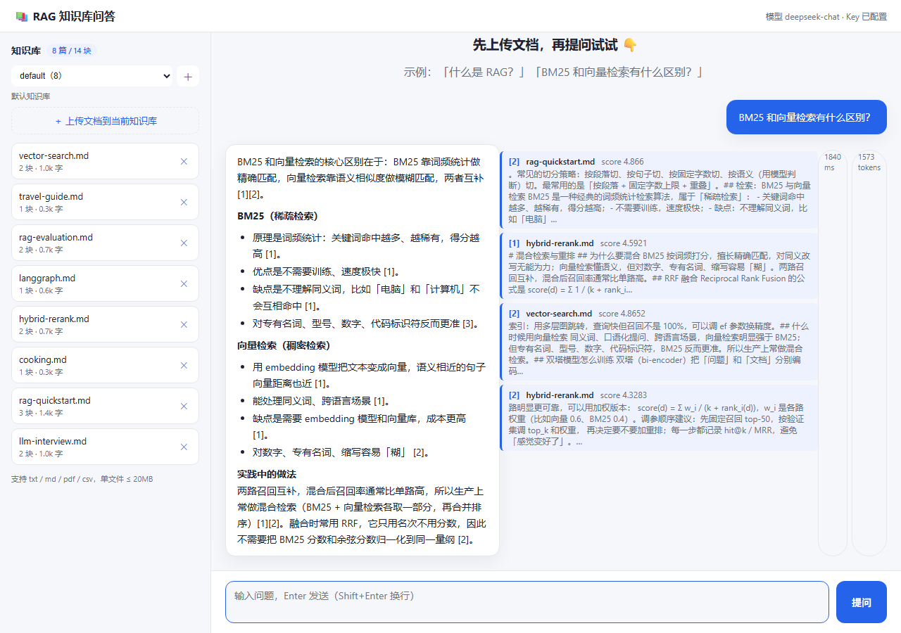
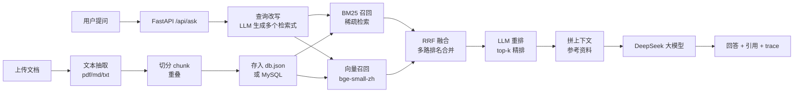

# 📚 RAG 知识库问答

> [English version](README.en.md)

一个**开箱即用**的 RAG（检索增强生成）知识库问答系统：上传文档 → 自动切分 → 混合检索（BM25 + 向量）→ 查询改写 + 重排 → 让大模型基于资料回答，并标注引用来源。

- 纯 Python，**不需要 GPU**，不需要独立向量数据库，`pip install` 五分钟跑起来
- 检索链路可拆可换：BM25 / 向量检索 / RRF 融合 / LLM 重排 / 查询改写，每一层都能单独关掉做对比
- 前端 + 后端 + 测试 + CI 齐全，适合作为**实习/求职项目**
- 中文场景优化：按句切分、中文分词、bge 中文向量模型、引用可追溯

[](https://github.com/HDC233666/rag-knowledge-base/actions/workflows/ci.yml)




---

## 功能

| 功能 | 说明 |
|---|---|
| 文档上传 | 支持 txt / md / pdf / csv / log，单文件 ≤ 20MB |
| 自动切分 | 按句切分 + 目标字数 + 重叠，避免语义被切断 |
| 混合检索 | BM25（词频）+ 向量检索（bge-small-zh，CPU 可跑），RRF 融合两路排名 |
| 查询改写 | 让大模型把一个问题改写成多个检索式（多查询召回），提升召回率 |
| 重排 | 对候选片段重排：LLM 打分（默认）或 bge-reranker 交叉编码器（本地 CPU，几十毫秒） |
| 结果缓存 | 改写/重排结果落 SQLite + TTL，重复问题从「秒级」降到「毫秒级」 |
| 回答 + 引用 | 回答里带 `[1][2]` 编号，界面展示每条引用的来源片段和得分 |
| 防幻觉 | 提示词强约束「资料里没有就说没有」；检索为空时直接拒答 |
| 持久化 | 默认存 `data/db.json`，重启不丢；配置 MySQL 后存数据库（见「接入 MySQL」） |
| MySQL 存储 | 可选：文档 + 切分块入库，演示表设计、索引、外键级联；连不上自动降级 JSON |
| 检索评估 | 内置 60+ 题评估集 + 脚本，一键对比 BM25 / 混合 / 重排 / 改写的 hit@1、hit@3、MRR |
| 流式回答 | `/api/ask/stream` 走 SSE：先推检索结果，再逐字推回答；界面边生成边显示 |
| 多轮对话 | 前端自动带上最近几轮问答，追问（「那向量检索的缺点呢？」）能接上文 |
| 限流 | 每 IP 每分钟请求数上限（`RAG_RATE_LIMIT`），超限返回 429，防止接口被刷 |
| 界面 | 原生 HTML/CSS/JS，无构建工具，支持深色模式，回答自动渲染 Markdown |
| 测试 | pytest，33 个用例覆盖切分/检索/融合/重排/缓存/接口/流式/限流；GitHub Actions 自动跑 |

## 架构



> 任一环节都可以用 `.env` 关掉（`RAG_ENABLE_REWRITE=0` / `RAG_ENABLE_RERANK=0`），关掉后自动降级，方便做消融对比。

## 快速开始

**环境要求**：Python 3.11+（Windows / macOS / Linux 均可）

```bash
# 1. 进入项目目录
cd rag-knowledge-base

# 2. 创建虚拟环境（推荐，避免污染全局 Python）
python -m venv .venv
# Windows:
.venv\Scripts\activate
# macOS / Linux:
source .venv/bin/activate

# 3. 安装依赖
pip install -r requirements.txt

# 4. 配置 Key：复制 .env.example 为 .env，填入你的 DeepSeek API Key
#    （如果系统里已经设置过 DEEPSEEK_API_KEY 环境变量，可跳过）
copy .env.example .env
notepad .env

# 5. 启动
uvicorn app.main:app --reload
```

浏览器打开 **http://127.0.0.1:8000** 即可。

> 第一次启动会自动把 `data/sample/` 里的示例文档导入，可以直接问「什么是 RAG？」试试。
> 接口文档：http://127.0.0.1:8000/docs

### 配置项（.env）

| 变量 | 默认值 | 说明 |
|---|---|---|
| `DEEPSEEK_API_KEY` | 空 | DeepSeek API Key（也可用系统环境变量） |
| `DEEPSEEK_BASE_URL` | `https://api.deepseek.com` | OpenAI 兼容接口地址 |
| `DEEPSEEK_MODEL` | `deepseek-chat` | 模型名，可换 `deepseek-reasoner` 等 |
| `RAG_TOP_K` | `4` | 每次检索喂给模型的片段数 |
| `RAG_CHUNK_SIZE` | `600` | 每块目标字数 |
| `RAG_CHUNK_OVERLAP` | `80` | 相邻块重叠字数 |
| `RAG_TEMPERATURE` | `0.2` | 回答温度 |
| `RAG_EMBED_MODEL` | `BAAI/bge-small-zh-v1.5` | 向量模型（CPU 可跑，512 维）；换模型后向量自动重建 |
| `RAG_EMBED_BACKEND` | `auto` | 设 `hash` 强制用零依赖哈希向量（CI/无网环境用） |
| `RAG_EMBED_QUERY_PREFIX` | bge 查询指令 | bge 系列查询侧建议加的指令前缀，换模型可留空 |
| `RAG_CANDIDATE_K` | `12` | BM25 与向量各召回多少候选，再融合 |
| `RAG_RRF_K` | `60` | RRF 融合常数（论文经验值） |
| `RAG_ENABLE_REWRITE` | `1` | 查询改写开关；`0` = 省一次大模型调用 |
| `RAG_ENABLE_RERANK` | `1` | 重排开关；`0` = 省一次重排开销 |
| `RAG_RERANK_BACKEND` | `llm` | 重排后端：`llm`（LLM 打分）或 `cross`（bge-reranker 交叉编码器，本地 CPU） |
| `RAG_CROSS_ENCODER_MODEL` | `BAAI/bge-reranker-base` | `cross` 后端用的模型 |
| `RAG_ENABLE_CACHE` | `1` | 改写/重排结果缓存开关（SQLite + TTL） |
| `RAG_CACHE_TTL` | `3600` | 缓存有效期（秒） |
| `RAG_CACHE_PATH` | `data/cache.db` | 缓存文件位置（已 gitignore） |
| `RAG_RATE_LIMIT` | `60` | 每 IP 每分钟问答次数上限，`0` = 关闭 |
| `RAG_DB_HOST` | 空 | 填了就用 MySQL；留空用 JSON 文件 |
| `RAG_DB_PORT` | `3306` | MySQL 端口 |
| `RAG_DB_USER` | `root` | 数据库账号 |
| `RAG_DB_PASSWORD` | 空 | 数据库密码（只写进 `.env`，别提交） |
| `RAG_DB_NAME` | `rag_kb` | 数据库名 |

## API

| 方法 | 路径 | 说明 |
|---|---|---|
| GET | `/api/health` | 健康检查（含模型名、Key 是否配置） |
| GET | `/api/stats` | 知识库统计（文档数 / 块数 / 字数） |
| GET | `/api/documents` | 文档列表 |
| POST | `/api/documents` | 创建文档（JSON：`{name, text}`） |
| POST | `/api/upload` | 上传文件（multipart） |
| DELETE | `/api/documents/{id}` | 删除文档 |
| POST | `/api/ask` | 提问（JSON：`{question, top_k?, history?}`）→ 一次性返回 |
| POST | `/api/ask/stream` | 同上入参，**SSE 流式**：`trace` / `delta` / `done` 事件 |

流式接口的事件（每条 `data: {...}`）：

| 事件 | 载荷 | 含义 |
|---|---|---|
| `trace` | `{queries, rewrite, rerank, candidates, citations}` | 检索完成，先把引用与 trace 推给前端 |
| `delta` | `{text}` | 回答增量文本（逐字显示） |
| `done` | `{answer, citations, latency_ms, tokens, trace}` | 整轮结束 |
| `error` | `{detail}` | 出错 |

示例：

```bash
curl -X POST http://127.0.0.1:8000/api/ask ^
  -H "Content-Type: application/json" ^
  -d "{\"question\": \"什么是 RAG？\"}"
```

限流：默认每个 IP 每分钟 60 次（`RAG_RATE_LIMIT`，设为 0 关闭）。超限返回 `429 {"detail": "请求太频繁了，稍后再试"}`，`/api/health` 不受限。

## 项目结构

```
rag-knowledge-base/
├── app/
│   ├── main.py        # FastAPI 入口 + 路由
│   ├── config.py      # 配置（环境变量 / .env）
│   ├── loaders.py     # 文件 → 文本（pdf/md/txt）
│   ├── chunking.py    # 文本切分（句子 + 重叠）
│   ├── embeddings.py  # 向量模型（bge-small-zh / 哈希降级）
│   ├── vectorstore.py # 向量索引（numpy 余弦检索）
│   ├── retrieval.py   # BM25 + 向量混合检索（RRF 融合）
│   ├── rewrite.py     # 查询改写（多查询）
│   ├── rerank.py      # LLM 重排
│   ├── store.py       # 文档仓库（JSON 实现，默认）
│   ├── db.py          # MySQL 存储实现 + 自动降级
│   ├── llm.py         # 调用 DeepSeek（重试 + 报错）
│   └── rag.py         # RAG 主流程（改写→混合召回→融合→重排→生成）
├── static/            # 前端（无构建工具）
├── data/
│   ├── sample/        # 示例知识库（含干扰文档，评估用）
│   ├── eval/          # 评估集（questions.json）与报告（report.json）
│   └── db.json        # 运行时生成（已 gitignore；用 MySQL 时不生成）
├── scripts/
│   ├── evaluate.py    # 检索评估：hit@1 / hit@3 / MRR 多配置对比
│   └── smoke.py       # 真实接口冒烟
├── docs/
│   └── LEARNING-RAG-ADVANCED.md  # 面向零基础的进阶讲解（原理 + 评估 + 面试问答）
├── tests/             # pytest 测试（33 个用例）
└── .github/workflows/ci.yml
```

## 运行测试

```bash
pytest -q
```

## 检索评估

内置 62 道题（含语义改写题、干扰文档题）和 `scripts/evaluate.py`，一次跑四种配置，直接对比检索质量：

```bash
python scripts/evaluate.py          # 需要 .env 里配好 Key（重排/改写要用大模型）
python scripts/evaluate.py --no-llm # 只对比 BM25 与混合检索，不花钱
```

指标说明：**hit@1** = 正确片段排第 1 的比例；**hit@3** = 排进前 3 的比例；**MRR** = 正确片段排名的倒数均值（越接近 1 越好）。

当前基线（14 个切片、62 道题、bge-small-zh）：

| 配置 | hit@1 | hit@3 | MRR | 平均延迟 |
|---|---|---|---|---|
| 纯 BM25 | 0.66 | 0.90 | 0.767 | 4 ms |
| 混合召回（BM25 + 向量，RRF） | 0.66 | 0.90 | 0.781 | 19 ms |
| 混合召回 + LLM 重排 | 0.73 | 0.94 | 0.831 | 1.45 s |
| 混合召回 + 查询改写 + 重排 | **0.77** | **0.97** | **0.864** | 2.63 s |

> 结论：小语料上 BM25 本身就不弱（词面匹配多），**收益主要来自「重排」和「查询改写」**；混合召回把 MRR 从 0.767 抬到 0.781（向量补上了「换个说法」的题），但 hit@1/hit@3 不变——这正是评估集的意义：不上评估，你无法知道改动到底是提升还是折腾。
> 延迟从 4ms 涨到 2.6s，是因为重排和改写都调用了大模型；这就是为什么要做缓存（见下）。

### 缓存效果

改写/重排结果按「问题 + 候选指纹」缓存在 SQLite（`RAG_CACHE_TTL`，默认 1 小时）。同一批问题重复请求：

| 场景 | 平均耗时 |
|---|---|
| 首次（冷启动，改写 + 重排各一次 LLM 调用） | 1.4 ~ 2.6 s |
| 命中缓存（改写、重排分数都直接读 SQLite） | **28 ms**（约 50 倍） |

> 生产里这就是「把贵的东西算一次」：模型没变、语料没变，答案就该能复用。

### 重排后端对比

| 后端 | 说明 | 延迟 | 依赖 |
|---|---|---|---|
| `llm`（默认） | 让大模型给候选打 0~10 分 | ~1.4 s | 需要 API Key |
| `cross` | bge-reranker 交叉编码器（fastembed/ONNX 本地推理） | 几十 ms | 首次需下载模型（约 100 MB） |

`cross` 模式如果模型下载失败或推理报错，会自动回退到 `llm` 重排，链路不会断。

## 进阶：接入 MySQL（可选）

默认使用 JSON 文件存储；需要数据库存储时，可切换为 MySQL（无需改代码）：

**1. 建库建账号（一次即可）**

```sql
CREATE DATABASE rag_kb DEFAULT CHARACTER SET utf8mb4;
CREATE USER 'dsh_app'@'localhost' IDENTIFIED BY '你的密码';
GRANT ALL PRIVILEGES ON rag_kb.* TO 'dsh_app'@'localhost';
```

**2. 在 `.env` 里填数据库连接**

```ini
RAG_DB_HOST=127.0.0.1
RAG_DB_PORT=3306
RAG_DB_USER=dsh_app
RAG_DB_PASSWORD=你的密码
RAG_DB_NAME=rag_kb
```

**3. 重启服务**，`/api/stats` 返回 `"storage": "mysql"` 就成功了（表会自动创建）。用 DataGrip / Navicat 打开 `rag_kb` 就能看到数据。

**表结构**（建表 SQL 在 `app/db.py`）：

| 表 | 字段 | 说明 |
|---|---|---|
| `documents` | id, name, chunks, chars, created_at | 一篇文档一行 |
| `chunks` | id, doc_id, idx, text, chars | 一个切分块一行，`doc_id` 外键关联 `documents` |

**设计要点：**

- **外键 + 级联删除**：`ON DELETE CASCADE` 保证删文档时自动清掉它的所有块，不留孤儿数据；
- **索引**：`doc_id` 上建索引，按文档查块、级联删除都不全表扫描；
- **降级**：数据库连不上时自动退回 JSON 存储（`make_store()`），保证 demo 在任何电脑都能跑；
- **取舍**：目前每次操作新建连接 + autocommit（教学演示够用），生产应换连接池，并给 `text` 加全文索引或接向量库。

## 设计说明

**为什么从 BM25 升级到混合检索（而不是一把梭上向量）？**

- BM25 是词面匹配，毫秒级、零依赖，在「问题里带着原文关键词」时非常准；
- 向量检索补的是「换个说法」：用户说「资料更新了模型还在答旧的」，文档里写的是「外挂知识库能随时更新」，词面不重合，向量能对上；
- 两路各召回 `RAG_CANDIDATE_K` 个候选，用 **RRF（Reciprocal Rank Fusion）** 按排名融合——它只看名次不看分数，天然避免「BM25 分和余弦相似度量纲不同」的问题，`score = Σ 1/(k + rank)`；
- 向量模型选 `bge-small-zh-v1.5`：512 维、CPU 可跑、中文效果好，不需要 GPU 和独立向量库；查询侧按 bge 官方建议加指令前缀，文档侧不加。

**为什么加 LLM 重排和查询改写？**

- 重排：召回阶段追求「别漏」（top-12 宽召回），重排阶段追求「排得准」（LLM 给候选打相关性分，取前 4）；
- 改写：用户问题往往口语化、信息少，让大模型改写成 2–3 个检索式分别召回再融合，能明显提升命中率（评估集上 hit@1 从 0.73 → 0.77）；
- 两者都靠大模型，代价是延迟（毫秒级 → 秒级），所以做成开关，可评估、可关闭。

**为什么加流式、多轮与限流？**

- 流式：检索 + 生成要 1–2 秒，全量返回前界面是空白的；SSE 先把检索 trace 和引用推给前端，再逐字推回答，等待感明显下降；
- 多轮：追问（「那它的缺点呢？」）不带上下文会被当成新问题，前端带最近 6 条消息后体验才像聊天助手；
- 限流：问答要花 token，公开 demo 被刷会烧钱；按 IP 每分钟限 60 次，超限 429，健康检查放行。

**降级策略（面试常问）**

- 向量模型加载失败 → 自动退化为哈希向量（`HashEmbedder`），保证服务不挂；
- 某一路检索异常 → 退化为纯 BM25；
- 重排/改写输出不是合法 JSON → 保留原顺序（重排）或退回原问题（改写）；
- MySQL 连不上 → 退化为 JSON 存储。

正确性靠测试保证：`tests/test_hybrid.py`、`tests/test_pipeline.py` 覆盖了融合排序、坏输出兜底、trace 字段等边界。

**如何扩展到生产可用？**

1. 存储：JSON（默认）→ MySQL（已支持）→ 向量库（Chroma / Milvus）；
2. 检索：混合检索（已支持）→ 向量库 HNSW 索引 + 多路召回；
3. 切分：按格式（Markdown 标题、PDF 版面）结构化切分；
4. 评估：当前 62 题偏小，可扩到 100+ 题、接入 RAGAS 自动评估生成质量；
5. 工程：权限控制、日志与监控、重排缓存（已支持）、多轮对话（已支持）、限流（已支持）。

## Roadmap

- [x] MySQL 存储后端（documents / chunks 两张表）
- [x] 向量检索（bge-small-zh）+ BM25 混合检索（RRF 融合）
- [x] LLM 重排 + 查询改写
- [x] 检索评估（62 题，hit@1 / hit@3 / MRR，多配置对比）
- [x] 流式回答（SSE，检索 trace + 回答逐字）
- [x] 多轮对话上下文（前端携带最近几轮）
- [x] 每 IP 限流（`RAG_RATE_LIMIT`）
- [ ] 向量库（Chroma / FAISS）替换内存索引
- [ ] 答案评分/反馈按钮
- [ ] Docker 部署

## 安全提示

`.env`（含 API Key 与数据库密码）和 `data/db.json` 已在 `.gitignore` 中忽略，不会提交到仓库；本 README 与示例配置里也不含任何真实密钥。

## 常见问题

- **报错 `没有找到 DEEPSEEK_API_KEY`**：检查 `.env` 是否在项目根目录、是否填了值；或设置系统环境变量后重启终端。
- **接口报 404 / model not found**：`.env` 里的 `DEEPSEEK_MODEL` 换回 `deepseek-chat`。
- **回答「知识库里没有找到」**：先确认侧边栏有文档；换了说法的问题一般也能被混合检索找到，若仍不行，换个更贴近原文的关键词再问。
- **PDF 抽不出文字**：扫描版 PDF 是图片，需要 OCR（本项目暂不支持）。

## 许可证

[MIT](LICENSE)
