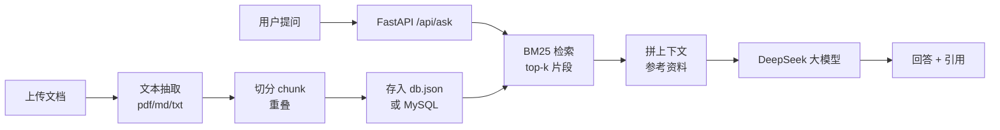

# 📚 RAG 知识库问答

> [English version](README.en.md)

一个**开箱即用**的 RAG（检索增强生成）知识库问答系统：上传文档 → 自动切分 → 检索 → 让大模型基于资料回答，并标注引用来源。

- 纯 Python，**不需要 GPU**，不需要向量数据库，`pip install` 五分钟跑起来
- 前端 + 后端 + 测试 + CI 齐全，适合作为**实习/求职项目**
- 中文场景优化：按句切分、中文分词、引用可追溯

[](https://github.com/your-name/rag-knowledge-base/actions/workflows/ci.yml)


---

## 功能

| 功能 | 说明 |
|---|---|
| 文档上传 | 支持 txt / md / pdf / csv / log，单文件 ≤ 20MB |
| 自动切分 | 按句切分 + 目标字数 + 重叠，避免语义被切断 |
| 检索 | BM25（纯 Python，毫秒级），中文单字 + 二元组分词 |
| 回答 + 引用 | 回答里带 `[1][2]` 编号，界面展示每条引用的来源片段和得分 |
| 防幻觉 | 提示词强约束「资料里没有就说没有」；检索为空时直接拒答 |
| 持久化 | 默认存 `data/db.json`，重启不丢；配置 MySQL 后存数据库（见「接入 MySQL」） |
| MySQL 存储 | 可选：文档 + 切分块入库，演示表设计、索引、外键级联；连不上自动降级 JSON |
| 界面 | 原生 HTML/CSS/JS，无构建工具，支持深色模式，回答自动渲染 Markdown |
| 测试 | pytest，覆盖切分/检索/接口；GitHub Actions 自动跑 |

## 架构



## 快速开始

**环境要求**：Python 3.11+（Windows / macOS / Linux 均可）

```bash
# 1. 进入项目目录
cd rag-knowledge-base

# 2. 创建虚拟环境（推荐，避免污染全局 Python）
python -m venv .venv
# Windows:
.venv\Scripts\activate
# macOS / Linux:
source .venv/bin/activate

# 3. 安装依赖
pip install -r requirements.txt

# 4. 配置 Key：复制 .env.example 为 .env，填入你的 DeepSeek API Key
#    （如果系统里已经设置过 DEEPSEEK_API_KEY 环境变量，可跳过）
copy .env.example .env
notepad .env

# 5. 启动
uvicorn app.main:app --reload
```

浏览器打开 **http://127.0.0.1:8000** 即可。

> 第一次启动会自动把 `data/sample/` 里的示例文档导入，可以直接问「什么是 RAG？」试试。
> 接口文档：http://127.0.0.1:8000/docs

### 配置项（.env）

| 变量 | 默认值 | 说明 |
|---|---|---|
| `DEEPSEEK_API_KEY` | 空 | DeepSeek API Key（也可用系统环境变量） |
| `DEEPSEEK_BASE_URL` | `https://api.deepseek.com` | OpenAI 兼容接口地址 |
| `DEEPSEEK_MODEL` | `deepseek-chat` | 模型名，可换 `deepseek-reasoner` 等 |
| `RAG_TOP_K` | `4` | 每次检索喂给模型的片段数 |
| `RAG_CHUNK_SIZE` | `600` | 每块目标字数 |
| `RAG_CHUNK_OVERLAP` | `80` | 相邻块重叠字数 |
| `RAG_TEMPERATURE` | `0.2` | 回答温度 |
| `RAG_DB_HOST` | 空 | 填了就用 MySQL；留空用 JSON 文件 |
| `RAG_DB_PORT` | `3306` | MySQL 端口 |
| `RAG_DB_USER` | `root` | 数据库账号 |
| `RAG_DB_PASSWORD` | 空 | 数据库密码（只写进 `.env`，别提交） |
| `RAG_DB_NAME` | `rag_kb` | 数据库名 |

## API

| 方法 | 路径 | 说明 |
|---|---|---|
| GET | `/api/health` | 健康检查（含模型名、Key 是否配置） |
| GET | `/api/stats` | 知识库统计（文档数 / 块数 / 字数） |
| GET | `/api/documents` | 文档列表 |
| POST | `/api/documents` | 创建文档（JSON：`{name, text}`） |
| POST | `/api/upload` | 上传文件（multipart） |
| DELETE | `/api/documents/{id}` | 删除文档 |
| POST | `/api/ask` | 提问（JSON：`{question, top_k?}`） |

示例：

```bash
curl -X POST http://127.0.0.1:8000/api/ask ^
  -H "Content-Type: application/json" ^
  -d "{\"question\": \"什么是 RAG？\"}"
```

## 项目结构

```
rag-knowledge-base/
├── app/
│   ├── main.py        # FastAPI 入口 + 路由
│   ├── config.py      # 配置（环境变量 / .env）
│   ├── loaders.py     # 文件 → 文本（pdf/md/txt）
│   ├── chunking.py    # 文本切分（句子 + 重叠）
│   ├── retrieval.py   # BM25 检索
│   ├── store.py       # 文档仓库（JSON 实现，默认）
│   ├── db.py          # MySQL 存储实现 + 自动降级
│   ├── llm.py         # 调用 DeepSeek（重试 + 报错）
│   └── rag.py         # RAG 主流程（检索→拼上下文→生成）
├── static/            # 前端（无构建工具）
├── data/
│   ├── sample/        # 示例知识库
│   └── db.json        # 运行时生成（已 gitignore；用 MySQL 时不生成）
├── tests/             # pytest 测试
├── docs/LEARNING.md   # 零基础讲解 + 面试问答
└── .github/workflows/ci.yml
```

## 运行测试

```bash
pytest -q
```

## 进阶：接入 MySQL（可选）

想让简历上多一条「MySQL 表设计」，把存储从 JSON 换成 MySQL 不用改代码，只需配置：

**1. 建库建账号（一次即可）**

```sql
CREATE DATABASE rag_kb DEFAULT CHARACTER SET utf8mb4;
CREATE USER 'dsh_app'@'localhost' IDENTIFIED BY '你的密码';
GRANT ALL PRIVILEGES ON rag_kb.* TO 'dsh_app'@'localhost';
```

**2. 在 `.env` 里填数据库连接**

```ini
RAG_DB_HOST=127.0.0.1
RAG_DB_PORT=3306
RAG_DB_USER=dsh_app
RAG_DB_PASSWORD=你的密码
RAG_DB_NAME=rag_kb
```

**3. 重启服务**，`/api/stats` 返回 `"storage": "mysql"` 就成功了（表会自动创建）。用 DataGrip / Navicat 打开 `rag_kb` 就能看到数据。

**表结构**（建表 SQL 在 `app/db.py`）：

| 表 | 字段 | 说明 |
|---|---|---|
| `documents` | id, name, chunks, chars, created_at | 一篇文档一行 |
| `chunks` | id, doc_id, idx, text, chars | 一个切分块一行，`doc_id` 外键关联 `documents` |

**设计点（面试可以讲）：**

- **外键 + 级联删除**：`ON DELETE CASCADE` 保证删文档时自动清掉它的所有块，不留孤儿数据；
- **索引**：`doc_id` 上建索引，按文档查块、级联删除都不全表扫描；
- **降级**：数据库连不上时自动退回 JSON 存储（`make_store()`），保证 demo 在任何电脑都能跑；
- **取舍**：目前每次操作新建连接 + autocommit（教学演示够用），生产应换连接池，并给 `text` 加全文索引或接向量库。

## 设计说明

**为什么用 BM25 而不是向量检索？**

- 零依赖：不用下载 embedding 模型（动辄 100MB+）、不用搭向量库；
- 够用：单机小知识库场景，BM25 效果不差且毫秒级返回；
- 可替换：`app/retrieval.py` 只有一个 `search()` 函数，想换 FAISS / Chroma / Milvus 只需替换实现，`rag.py` 不用动。

**如何扩展到生产可用？**

1. 检索：BM25 → 混合检索（BM25 + 向量）+ rerank；
2. 存储：JSON（默认）→ MySQL（已支持）→ 向量库；
3. 切分：按格式（Markdown 标题、PDF 版面）结构化切分；
4. 评估：加一套 RAGAS 评估集，回归测试效果；
5. 工程：多轮对话、权限控制、限流、日志与监控。

## Roadmap

- [x] MySQL 存储后端（documents / chunks 两张表）
- [ ] 向量检索（FAISS/Chroma）+ 混合检索
- [ ] 多轮对话上下文
- [ ] 文档删除后的索引一致性校验
- [ ] 答案评分/反馈按钮
- [ ] Docker 部署

## 安全提示

`.env`（含 API Key 与数据库密码）和 `data/db.json` 已在 `.gitignore` 中忽略，不会提交到仓库；本 README 与示例配置里也不含任何真实密钥。

## 常见问题

- **报错 `没有找到 DEEPSEEK_API_KEY`**：检查 `.env` 是否在项目根目录、是否填了值；或设置系统环境变量后重启终端。
- **接口报 404 / model not found**：`.env` 里的 `DEEPSEEK_MODEL` 换回 `deepseek-chat`。
- **回答「知识库里没有找到」**：先确认侧边栏有文档；中文检索对同义词不敏感，可以换个关键词问。
- **PDF 抽不出文字**：扫描版 PDF 是图片，需要 OCR（本项目暂不支持）。

## 许可证

[MIT](LICENSE)
