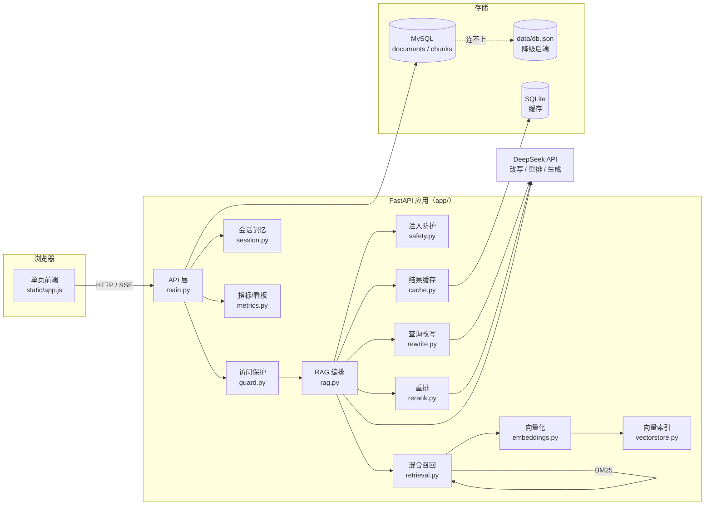
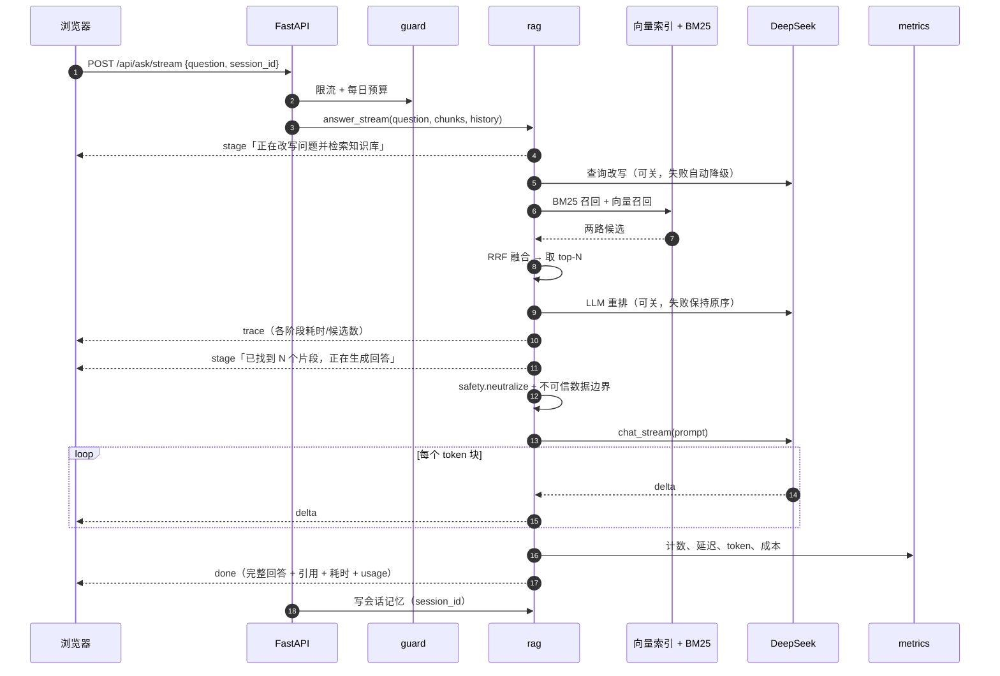
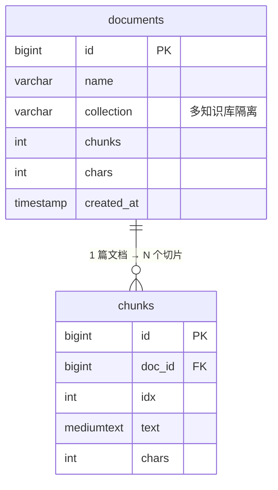

# 架构说明

> 面试现场可以按「一张图 → 一条链路 → 三个取舍」来讲：图是下面这些 Mermaid，链路是 `/api/ask/stream`，取舍见文末。

## 1. 组件与边界



要点：

- **API 层只做参数校验和错误映射**，编排全在 `rag.py`，所以「离线评估脚本」和「线上接口」跑的是同一条检索链路（`scripts/evaluate.py` 直接调 `rag.retrieve`）。
- **存储可降级**：MySQL 连不上自动回退 `data/db.json`，演示环境不会因为数据库挂了而白屏。
- **向量索引可降级**：有 `faiss` 用 HNSW，没有就用 numpy 精确检索；`RAG_VECTOR_BACKEND=auto` 自动选。

## 2. 一次流式问答的时序



失败路径都做了降级：改写失败用原问题、重排失败保持 RRF 顺序、大模型报错在 SSE 里发 `error` 事件、前端能拿到可读 `detail`。

## 3. 检索链路的数据形状

```mermaid
flowchart TD
    Q[用户问题] --> QW[改写：原问题 + 2 个同义问法]
    QW --> BM[BM25 关键词召回<br/>CANDIDATE_K=12]
    QW --> VE[向量召回<br/>bge-small-zh + HNSW<br/>CANDIDATE_K=12]
    BM --> RRF[RRF 融合<br/>score = Σ 1/(k+rank), k=60]
    VE --> RRF
    RRF --> RR[LLM 重排 → 取 TOP_K=4]
    RR --> CTX[片段 + 文档名 + 编号]
    CTX --> P[Prompt：规则 + 不可信资料边界 + 问题]
    P --> ANS[带编号引用的回答]
```

## 4. 数据库模型



## 5. 三个关键取舍（面试可直接讲）

| 决策 | 选了什么 | 为什么 | 代价 |
| --- | --- | --- | --- |
| 召回 | BM25 + 向量混合（RRF） | 单路都有明显短板：BM25 不懂同义词，向量对数字/型号/代码标识符弱；两路融合在 100 题上 hit@1 从 0.67 提到 0.74（加重排后 0.75） | 延迟从 3ms 涨到 ~2.6s；候选数要调 |
| 重排 | LLM 打分（可换 cross-encoder） | 少一个模型下载、少一份内存；失败时保持原序不影响可用性 | 每题多一次 API 调用，钱和延迟都涨 |
| 会话 | 服务端 session_id + 进程内 TTL 存储 | 客户端传 history 可以伪造、且长对话越传越大；服务端存最近 6 轮，注入时再截断 | 单机内存态，重启丢失；多实例要换 Redis |

另外两个小取舍：

- **注入防护只中和「硬模式」**：知识库里讨论提示注入的文章不该被删改，真正拦住注入的是「不可信数据边界 + 系统规则」。
- **指标自己写，不引 prometheus_client**：只需要计数、分位数、求和三件事，少一个依赖；暴露 `/api/metrics`（Prometheus 文本）+ `/api/dashboard`（JSON 给前端展示）。
